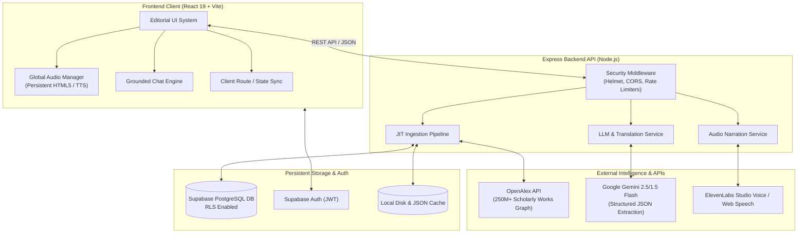
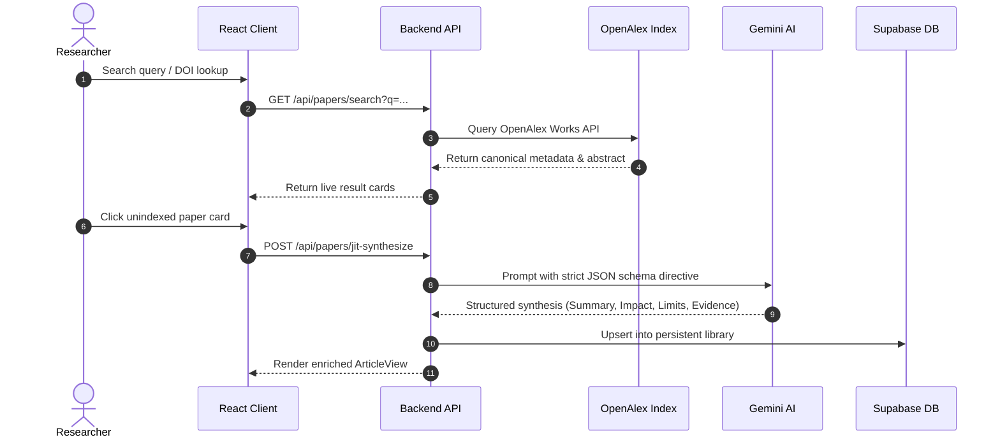
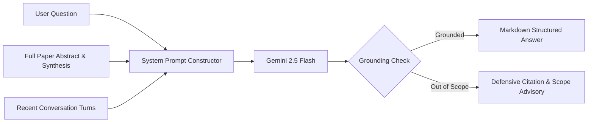

# Nexus — Platform Architecture & Developer Briefing

> **Executive Overview**: Nexus is an open-access **Scientific Research Intelligence Platform** engineered to bridge the gap between 250M+ dense peer-reviewed publications and intellectually curious builders, researchers, and engineers. It transforms dense academic literature into accessible, multi-perspective AI syntheses, studio audio narrations, real-time multilingual translations, and grounded interactive paper discussions.

---

## 1. What Problem Nexus Solves

1. **Information Density & Jargon Barrier**: Over 250M+ peer-reviewed papers are published, but their dense academic formatting prevents cross-disciplinary builders and decision-makers from extracting key insights quickly.
2. **Missing Multi-Perspective Breakdown**: Traditional abstracts summarize findings in a uniform block of text. Nexus decomposes every paper into **Plain Synthesis**, **Real-World Impact**, and **Methodological Limitations & Evidence Levels**.
3. **Language Barriers**: Most high-impact scientific literature is published exclusively in English. Nexus provides instant Gemini-powered scholarly translation into 10+ languages (Spanish, German, French, Turkish, Chinese, Japanese, Portuguese, Italian, Russian, Arabic).
4. **Interactive Ingestion & Discussion**: Users can query papers directly through grounded RAG chat ("Ask the Paper") and submit any live DOI for on-demand synthesis and audio narration.

---

## 2. High-Level System Architecture

Nexus is structured as a decoupled, high-performance architecture combining a responsive React SPA with an Express.js ingestion and intelligence backend, backed by Google Gemini AI, OpenAlex scholarly graph, and Supabase PostgreSQL with Row Level Security (RLS).

---

## 3. Core Subsystems & Technical Workflows

### A. Just-In-Time (JIT) DOI Ingestion & Synthesis Pipeline
When a user searches for an unindexed paper or inputs a raw DOI, Nexus fetches real-time metadata from OpenAlex, runs structured schema synthesis via Gemini, and caches the result permanently.

### B. Grounded Paper Discussion ("Ask the Paper")
To eliminate LLM hallucinations, the platform anchors questions strictly in the paper's extracted findings, methodology, and citations.

### C. Persistent Audio & Speech Synthesis Architecture
Audio narration survives full-page navigation, tab changes, and modal states through a singleton event-driven audio controller:

- **Primary Source**: Pre-generated or on-demand ElevenLabs studio voice streamed from the backend.
- **Resilient Fallback**: Zero-latency Browser Web Speech API (`window.speechSynthesis`) with simulated progress tracking and pitch/rate alignment.
- **Controls**: Micro-scrubber, `-15s` / `+15s` skip offsets, speed multipliers (`0.75x` – `2.0x`), and MP3 download.

---

## 4. Technology Stack Summary

| Layer | Technologies Used | Key Responsibilities |
| :--- | :--- | :--- |
| **Frontend SPA** | React 19, Vite, Vanilla CSS Design System | Responsive layout, theme switching (Dark/Light), keyboard navigation (<kbd>J</kbd>/<kbd>K</kbd>/<kbd>B</kbd>/<kbd>A</kbd>), state synchronization. |
| **Backend Service** | Node.js, Express.js | API routing, rate limiting (`express-rate-limit`), security (`helmet`, strict CORS, path traversal guards). |
| **AI / LLM Engine** | `@google/genai` (Gemini 2.5 Flash / 1.5 Flash fallback) | High-speed structured JSON synthesis, scholarly translation across 10+ languages, interactive paper chat. |
| **Academic Graph** | OpenAlex Works API, Crossref | Global indexing of 250M+ publications, Open Access PDF detection, author disambiguation. |
| **Audio Pipeline** | ElevenLabs Text-to-Speech API + Web Speech API | Dual-tier studio and native narration with global background playback. |
| **Database & Auth** | Supabase (PostgreSQL), JWT Auth, RLS | User authentication, personalized bookmarks, custom reading history, shared research curation. |

---

## 5. Developer Feedback & Discussion Questions

When sharing this platform with other engineers and architects, consider asking for their thoughts on these specific areas:

1. **AI Latency vs. Offline Caching**:
   - *How do you evaluate our JIT Gemini synthesis approach vs. background batch ingestion for 100k+ popular papers?*
2. **State Management & Audio Persistence**:
   - *Is the singleton `GlobalAudioManager` event-subscriber pattern optimal, or would React Context / Zustand provide better scaling as feature complexity increases?*
3. **Grounding & Guardrails**:
   - *What additional retrieval techniques (e.g. vector embedding chunks vs. full-abstract context window) would you recommend for longer 30-page PDF papers?*
4. **UI/UX Editorial Aesthetics**:
   - *How does the high-contrast editorial design (zero glassmorphism, Plus Jakarta Sans typography, structured data cards) hold up compared to traditional dashboard UIs?*
